### About me

I'm the CTO at **Scoutly**, where we're building an influencer marketplace for India. I also work as an **AI & Full-Stack Developer at KAN Universal**, an LED display company, where I build their ERP, online store and most of their internal tools.

Most of what I build is full-stack web apps with some AI inside them. I enjoy taking an idea all the way to something people actually use.

B.Tech in AI & Data Science from GGSIPU, Delhi.

 

### Things I've built

| | |
|---|---|
| **Scoutly**   AI agent that negotiates brand and creator deals, with payments and payouts built in   `FastAPI` `Postgres` `React` `OpenAI` | **Scoutly Atlas**   Search creators in plain English and get matched to campaigns   `FastAPI` `Next.js` `OpenAI` |
| **KAN ERP**   One app for purchase, stock and sales, on Android, iOS and the web   `Expo` `Hono` `Cloudflare Workers` | **Tender bid assistant**   Reads a government tender and drafts the bid with sources   `Python` `PydanticAI` `Postgres` |
| **Stashify**   Save anything and search it by meaning   `Next.js` `Drizzle` `OpenAI` | **LED wall streaming**   Streams a laptop screen to LED walls   `Rust` `Kotlin` |

### My skill shelf

### GitHub stats

